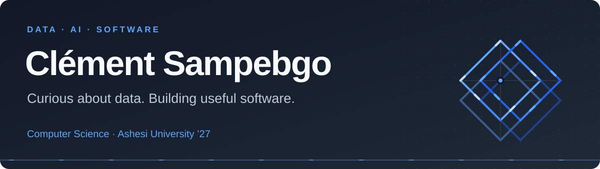
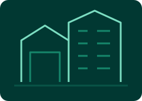
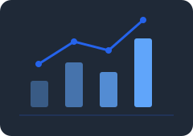

<picture>
  <source media="(max-width: 600px)" srcset="assets/header-mobile.svg">
  
</picture>

## Hello, I'm Clément.

I'm a **Computer Science student at Ashesi University, Class of 2027**, and a **Mastercard Foundation Scholar** from Burkina Faso. I enjoy exploring data, artificial intelligence, and software that helps people solve practical problems.

My perspective also draws on an academic exchange at **CESI in Aix-en-Provence, France**.

[Selected work](#selected-work) · [Tools I use](#tools-i-use) · [Let's connect](#lets-connect)

## What interests me

- **Data & AI** — finding patterns, understanding information, and exploring useful applications.
- **Software & databases** — building applications and organizing the data behind them.
- **Sustainability & local needs** — applying technology to everyday challenges.

## Selected work

<table>
<tr>
<td width="120"></td>
<td><strong><a href="https://github.com/CSampebgo333/maison-des-pagnes">Maison du Faso Dan Fani</a></strong> COMMERCE · BURKINA FASO  A French and English storefront for Faso Dan Fani textiles, with a visual catalogue, product galleries, and order requests.</td>
</tr>
<tr>
<td width="120"></td>
<td><strong><a href="https://github.com/CSampebgo333/lumavok-real-estate-platform">Lumavok</a></strong> REAL ESTATE · DATABASES  A bilingual property platform for Burkina Faso. My focus is database design, data management, and database security.</td>
</tr>
<tr>
<td width="120"></td>
<td><strong><a href="https://github.com/CSampebgo333/Consumer-Insights-Data-Analytics-Externship">Consumer Insights</a></strong> DATA ANALYTICS · BEATS BY DRE × EXTERN  Consumer-review exploration and sentiment analysis, using Python and Gemini to investigate opinions about audio products.</td>
</tr>
</table>

## Tools I use

  
  
  
  
  
  

## Let's connect

I'm happy to connect about data, AI, software projects, and practical ideas with a positive impact.

  
  

